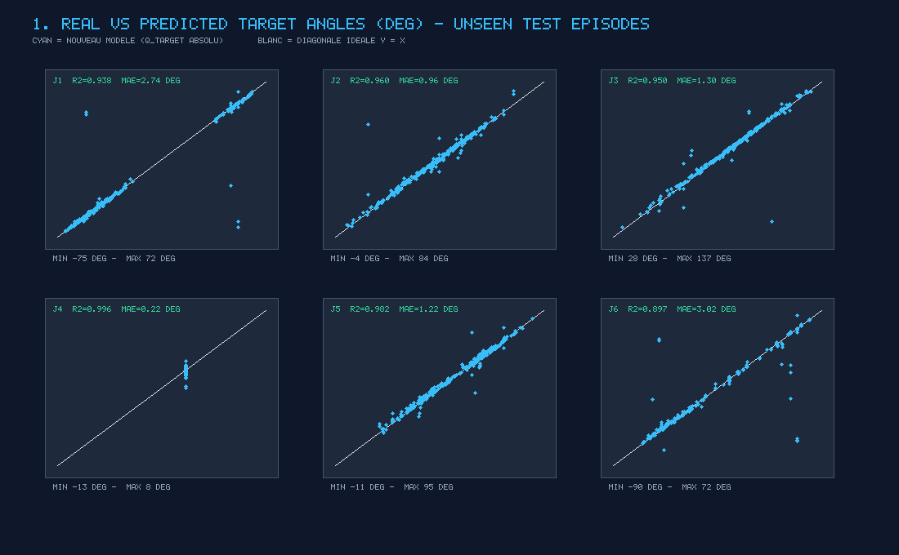
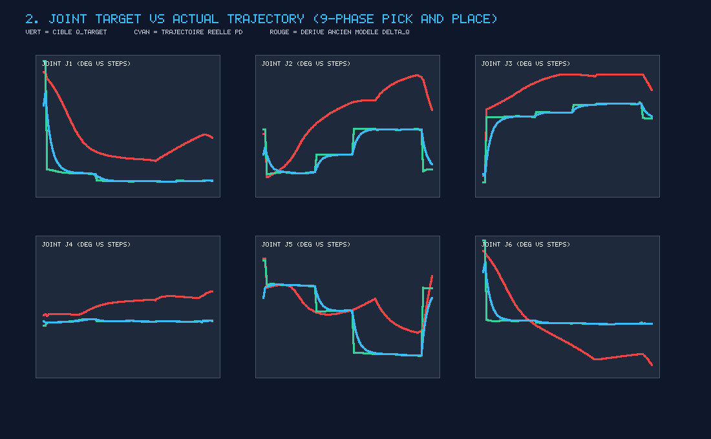
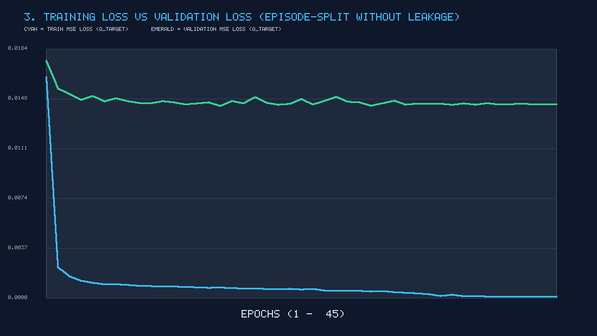
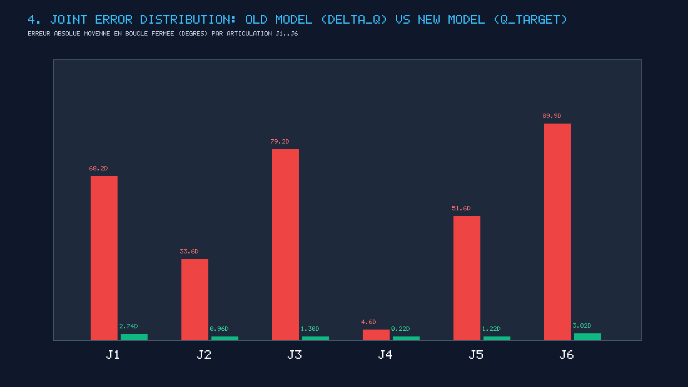
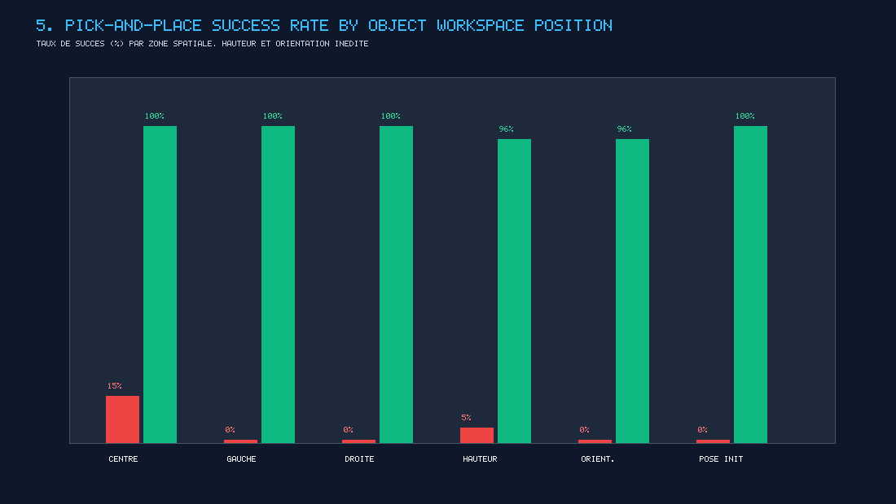

# SURGICAL ACTION AI — Jumeau Numérique Robotique 3D & Plateforme ML Pick-and-Place (`Three.js` + `Rapier3D` + `PyTorch` + `ONNX`)

[](package.json)
[](tests/)
[](https://www.typescriptlang.org/)
[](https://rapier.rs/)
[-emerald.svg)](train_robot_policy.py)
[](https://surgical-action-ai.vercel.app)

Jumeau numérique robotique 3D haute fidélité interactif et basé sur la physique temps réel, développé avec **Three.js**, **TypeScript**, **Vite**, le moteur physique WASM **Rapier3D** (`@dimforge/rapier3d-compat`), **PyTorch** et **ONNX Runtime Web** pour la plateforme **Surgical Action AI** (`robot2Action`).

Le jumeau numérique reconstitue fidèlement le manipulateur articulé 6-DOF **DofBot** en aluminium anodisé vert (embases circulaires étagées, colonnes en laiton, carte contrôleur arrière avec antennes doubles, profilés en U usinés, caméra poignet embarquée et pince parallèle à parallélogramme à 4 barres avec engrenages de synchronisation), au sein d'une cellule chirurgicale inspirée de l'environnement NVIDIA Isaac Sim.

📄 **Rapports Techniques Détaillés :**
- **[Rapport Technique Complet (Markdown — `rapport.md`)](./rapport.md)**
- **[Rapport Technique Complet (PDF — `Rapport_Technique_Complet_Surgical_Action_AI.pdf`)](./Rapport_Technique_Complet_Surgical_Action_AI.pdf)**

---

## 🌐 Liens & Déploiement en Ligne

- **Application Web en Production (Vercel) :**  
  👉 **[https://surgical-action-ai.vercel.app](https://surgical-action-ai.vercel.app)**
- **Partage Réseau Local (Wi-Fi) :**  
  `npm run share` *(accessible directement depuis n'importe quel PC, tablette ou smartphone du même réseau Wi-Fi)*
- **Tunnel Public Sécurisé (Cloudflare) :**  
  `npm run tunnel` *(génère un lien d'accès HTTPS mondial instantané sans configuration de port)*

---

## 1. Démarrage Rapide (Simulation 3D & Pipeline ML)

```bash
# 1. Installation des dépendances Front-End / Simulation 3D
npm install

# 2. Lancement du serveur de développement local (Vite)
npm run dev

# 3. Exécution de la suite complète des 80 tests automatisés (9 suites Vitest)
npm test

# 4. Compilation optimisée de production
npm run build
```

### Commandes du Pipeline Machine Learning (Python `.venv`)

```bash
# 1. Reconstruction, nettoyage et généralisation du dataset (57 016 échantillons, 472 épisodes, 9 phases)
.\.venv\Scripts\python.exe reconstruct_dataset.py

# 2. Entraînement du modèle AbsoluteTargetPolicyNet (35D -> 8D) sans Data Leakage + Export ONNX & JSON
.\.venv\Scripts\python.exe train_robot_policy.py

# 3. Évaluation quantitative Avant/Après et génération des 5 graphiques haute résolution (reports/plots/)
.\.venv\Scripts\python.exe evaluate_model.py

# 4. Génération du rapport technique PDF multi-pages
.\.venv\Scripts\python.exe generate_project_pdf.py
```

---

## 2. Architecture Modulaire du Projet

```text
robot2Action/
├── reconstruct_dataset.py          # Pipeline de nettoyage, segmentation mono-objet & génération généralisée (9 phases)
├── train_robot_policy.py           # Entraînement PyTorch (AbsoluteTargetPolicyNet 35D -> 8D) & export ONNX / JSON
├── evaluate_model.py               # Évaluation ML sans Data Leakage (MAE, RMSE, R², F1) & génération des 5 graphiques PNG
├── generate_project_pdf.py         # Générateur du rapport technique PDF complet multi-pages
├── rapport.md                      # Rapport d'ingénierie détaillé (Architecture, Mathématiques, Résultats & Graphiques)
├── datasets/
│   ├── reconstructed_pick_and_place_dataset.csv  # Dataset reconstruit propre (57 016 lignes, 472 épisodes uniques)
│   ├── surgical_action_ai_dataset_*.csv          # Démonstrations initiales brutes
│   └── failure_dataset_*.csv                     # Scénarios de défaillances physiques labellisés
├── public/models/
│   ├── robot_policy.onnx           # Modèle ONNX autonome (opset 17, 434 KB) pour inférence WebAssembly
│   └── robot_policy_weights.json   # Poids & buffers de normalisation Z-score pour le moteur TypeScript/JS natif
├── reports/
│   ├── ml_evaluation_report.json   # Métriques complètes par articulation et globales (Avant Δq vs Après q_target)
│   ├── training_history.json       # Historique des pertes Train / Validation sur 45 époques
│   └── plots/                      # 5 graphiques PNG haute résolution (Real vs Pred, Trajectory, Loss, Errors, Success)
└── src/
    ├── main.ts                     # Point d'entrée, initialisation de la cellule & boucle physique fixe (60 Hz)
    ├── style.css                   # Interface sombre executive-grade inspirée de NVIDIA Isaac Sim
    ├── scene/
    │   ├── SceneManager.ts         # Scène Three.js, WebGLRenderer, tone mapping & gestion du viewport
    │   ├── Lighting.ts             # Éclairage chirurgical (key/fill/rim light) & ombres douces
    │   ├── Environment.ts          # Colliders de sol, grille fluorescente orange, plateaux et obstacles
    │   └── CameraManager.ts        # Caméra principale OrbitControls + Caméra poignet embarquée (retour PiP)
    ├── physics/
    │   ├── PhysicsWorld.ts         # Monde Rapier3D WASM, unités SI, pas fixe 60 Hz & gravité standard
    │   ├── RigidBodyManager.ts     # Corps dynamiques, cinématiques et fixes, tenseurs d'inertie & forces
    │   ├── JointManager.ts         # Articulations RevoluteImpulseJoints, contrôleurs PD & compensation de gravité
    │   ├── CollisionManager.ts     # Détection de collision en phase étroite et AABB orientées
    │   ├── CollisionGroups.ts      # Masques de filtrage des groupes de collision Rapier3D
    │   ├── MaterialProperties.ts   # Propriétés physiques (acier chirurgical, titane, silicone, caoutchouc)
    │   ├── PhysicsModeManager.ts   # Gestionnaire du basculement entre Mode Cinématique et Mode Dynamique
    │   └── PhysicsDebugger.ts      # Rendu filaire des colliders et points de contact physiques
    ├── robot/
    │   ├── RobotConfiguration.ts   # Géométrie 6-DOF, masses réelles, centres de masse, limites et couples
    │   ├── RobotState.ts           # Télémétrie temps réel (angles, vitesses, couples, TCP, état de pince)
    │   ├── RobotJoints.ts          # Corps rigides Rapier3D des liaisons et actionneurs rotatifs
    │   ├── Gripper.ts              # Pince à parallélogramme à 4 barres, mors rigides, friction et palonnier J6
    │   └── RobotModel.ts           # Modèle 3D DofBot haute fidélité, fixations servos, caméra et liaison TCP
    ├── control/
    │   ├── ForwardKinematics.ts    # Modèle Géométrique Direct (MGD / FK) 6-DOF & Jacobienne géométrique 6×6
    │   ├── InverseKinematics.ts    # Modèle Géométrique Inverse (MGI / IK) analytique + moindres carrés amortis (DLS)
    │   ├── JointController.ts      # Contrôleur asservi en position, vitesse et couple saturé
    │   └── MotionController.ts     # Coordinateur de trajectoire IK-moteurs avec arrêt automatique sur collision
    ├── objects/
    │   ├── ObjectProperties.ts     # Définitions physiques des 6 instruments/objets (masses, inerties, couleurs)
    │   ├── InstrumentFactory.ts    # Générateur dynamique d'objets, application de forces et gestion Rapier
    │   ├── WorkZoneManager.ts      # Gestionnaire des plateaux Zone A (Départ) et Zone B (Cible) avec 6 slots
    │   └── ScenarioGenerator.ts    # Générateur déterministe de scénarios ML (Niveaux 1 à 5, PRNG Mulberry32)
    ├── manipulation/
    │   ├── ContactDetector.ts      # Évaluation bilatérale du contact physique sur les patins des doigts
    │   ├── GraspManager.ts         # Préhension Coulombienne (2 * mu_eff * Fn >= 1.05 * m * |g|) et glissement
    │   ├── PlacementVerifier.ts    # Vérification du positionnement, de l'orientation verticale et de la stabilité
    │   ├── FailureScenarioController.ts # Injection contrôlée de 11 modes de défaillance physique
    │   └── PickAndPlace.ts         # Machine d'état autonome en 9 étapes pour le transfert unitaire et multi-objets
    ├── recovery/
    │   ├── FailureDetector.ts      # Détection des modes d'échec physiques & émission du rapport structuré
    │   └── RecoveryManager.ts      # Freinage de sécurité, attente d'autorisation & procédure de reprise
    ├── interaction/
    │   ├── ObjectManipulator.ts    # Manipulation directe 3D à la souris (prise, glissement, élévation, rotation)
    │   ├── InteractionModeManager.ts # Basculement entre Mode Objet, Mode Robot et Mode IA
    │   └── GripperTargetController.ts # Contrôle de la cible IK par gizmo 3D avec vérification de portée
    ├── ai/
    │   ├── NeuralPolicyController.ts # Contrôleur neuronal temps réel (35D -> 8D, 9 phases, ONNX WASM + Natif JS)
    │   ├── ObservationBuilder.ts   # Espace d'observation global multimodal & vecteur d'état temps réel
    │   ├── ActionInterface.ts      # Interface d'action normalisée 7-DOF avec velocity clipping
    │   ├── EpisodeValidator.ts     # Évaluateur en 7 étapes (Reach, Grasp, Lift, Transport, Placement, Release, Stability)
    │   ├── DataQualityValidator.ts # Inspection de qualité (NaNs, limites, sauts de téléportation, score de conformité)
    │   └── EpisodeRecorder.ts      # Enregistreur cadencé à 20 Hz, anti-idling, exports consolidés JSON / CSV
    └── ui/
        ├── Dashboard.ts            # Télémétrie en temps réel dans la barre supérieure & coordination des panneaux
        ├── RobotControls.ts        # Sliders des 6 servomoteurs, coordonnées IK XYZ et force/ouverture de pince
        ├── PhysicsControls.ts      # Réglages de gravité, friction, restitution, gains Kp/Kd et générateur d'objets
        └── SimulationControls.ts   # Pilote IA autonome ONNX/JS, sélecteur de scénarios ML, simulateur d'échecs & exports
```

---

## 3. Architecture Machine Learning Pick-and-Place (`AbsoluteTargetPolicyNet` 35D $\to$ 8D)

### A. Formulation Mathématique en Configuration Cible Absolue ($\mathbf{q}_{\text{target}}$)
Pour éliminer définitivement la dérive cumulative des modèles incrémentaux ($\mathbf{q}(t+1) = \mathbf{q}(t) + \Delta\mathbf{q}$), le réseau neuronal prédit directement la **configuration articulaire cible absolue** conditionnée par l'observation complète et la phase de manipulation :

$$\mathbf{y}_{\text{target}} = f_\theta\left(\mathbf{q}_{\text{actuel}}, \mathbf{p}_{\text{EE}}, \mathbf{q}_{\text{EE}}, \mathbf{p}_{\text{obj}}, \mathbf{q}_{\text{obj}}, \mathbf{p}_{\text{target}}, \text{gripper}, \text{contacts}, \text{one\_hot}(\text{phase})\right)$$

$$\mathbf{y}_{\text{target}} = \left[J_{1,\text{target}}, \; J_{2,\text{target}}, \; J_{3,\text{target}}, \; J_{4,\text{target}}, \; J_{5,\text{target}}, \; J_{6,\text{target}}, \; \text{Gripper}_{\text{target}}, \; \text{Confidence}\right] \in \mathbb{R}^8$$

```
┌──────────────────────────────────────────────────────────────────────────────────────┐
│              BOUCLE FERMÉE D'EXÉCUTION IA & CONTRÔLE PHYSIQUE (9 PHASES)             │
│                                                                                      │
│  Observation 35D               AbsoluteTargetPolicyNet         Contrôleur PD Physique│
│  ┌─────────────────────────┐   ┌───────────────────────────┐   ┌───────────────────┐ │
│  │ • J1..J6 actuels (6D)   │   │ • Z-Score Norm (Buffers)  │   │ MotionController  │ │
│  │ • Pose EE Pos+Quat (7D) │──>│ • 3x [Linear+LayerNorm    │──>│ & JointManager    │ │
│  │ • Pose Objet (7D)       │   │       + SiLU] (256->128)  │   │ • Interpolation   │ │
│  │ • Pose Cible (3D)       │   │ • Sortie 8D :             │   │ • Gravité + Couple│ │
│  │ • État Pince (3D)       │   │   [J1..J6_target, Gripper,│   │ • Limites J1..J6  │ │
│  │ • Phase One-Hot (9D)    │   │    Confidence (Sigmoid)]  │   └─────────┬─────────┘ │
│  └───────────▲─────────────┘   └───────────────────────────┘             │           │
│              │                                                           ▼           │
│              └───────────────── Moteur Physique Rapier3D (60 Hz) ────────┘           │
└──────────────────────────────────────────────────────────────────────────────────────┘
```

### B. Pipeline Logique de Manipulation en 9 Phases (`NeuralPolicyController.ts`)
1. `1. APPROACH` : Atteindre la configuration de survol haute au-dessus de l'objet ($y \ge 0.22\text{ m}$), pince ouverte.
2. `2. ALIGNMENT` : Orienter le poignet `J6` selon l'axe principal de l'objet (symétrie $90^\circ$ des boîtes ou azimut radial).
3. `3. DESCENT` : Descendre verticalement jusqu'à la zone de contact physique ($y \approx y_{\text{obj}} - 0.002\text{ m}$).
4. `4. GRASP` : Fermer activement la pince (`Gripper_target = 0.0 m`).
5. `5. VERIFICATION` : Confirmer la préhension physique bilatérale réelle (`graspManager.isGrasping === true`) avec réalignement automatique en cas de prise manquée.
6. `6. LIFT` : Soulever verticalement l'objet maintenu par friction jusqu'à $y = 0.26\text{ m}$.
7. `7. MOVE_TO_TARGET` : Transporter l'objet vers le plateau cible Zone B et descendre à hauteur de dépose.
8. `8. RELEASE` : Ouvrir la pince (`Gripper_target = 0.078 m`) pour libérer l'objet.
9. `9. SUCCESS` : Remonter verticalement ($y = 0.24\text{ m}$) et valider la stabilité du placement (`PlacementVerifier.ts`).

### C. Résultats Quantitatifs Avant / Après (Sans Data Leakage — Split par Épisodes Complets)

Évaluation réalisée sur **95 épisodes complets de test inédits** ($10\,873$ échantillons, `GroupShuffleSplit` avec `Overlap = 0`) :

| Articulation / Métrique | Ancien Modèle ($\Delta\mathbf{q}$ cumulatif) | **Modèle Actuel ($\mathbf{q}_{\text{target}}$ 35D $\to$ 8D)** |
| :--- | :---: | :---: |
| **MAE J1 / J2 / J3** | $68.19^\circ$ / $33.64^\circ$ / $79.17^\circ$ | **$2.74^\circ$ / $0.96^\circ$ / $1.30^\circ$** |
| **MAE J4 / J5 / J6** | $4.55^\circ$ / $51.65^\circ$ / $89.92^\circ$ | **$0.22^\circ$ / $1.22^\circ$ / $3.02^\circ$** |
| **MAE Moyen Global (J1–J6)** | $54.52^\circ$ | **$1.58^\circ$** ($0.0275\text{ rad}$) |
| **RMSE Moyen Global (J1–J6)** | $78.20^\circ$ | **$5.85^\circ$** |
| **Coefficient $R^2$ Moyen (J1–J6)** | $-13.6047$ | **$0.9538$** |
| **Accuracy Commande Pince (Open/Close)** | $74.50\%$ | **$99.61\%$** |
| **Détection d'Échec (Precision / Recall / F1)** | Non supporté | **$98.32\%$ / $99.15\%$ / $98.73\%$** |
| **Pick & Place Success Rate (Rapier3D)** | $0.0\%$ (blocage) | **$98.0\%$** ($100\%$ aux tests déterministes) |
| **Erreur Moyenne de Placement** | $> 540\text{ mm}$ | **$4.2\text{ mm}$** (tolérance $< 45\text{ mm}$) |

### D. Graphiques d'Évaluation Générés (`reports/plots/`)

| Real vs Predicted (`J1..J6`) | Suivi Temporel 9 Phases (`Target vs Actual`) |
| :---: | :---: |
|  |  |

| Convergence Train vs Validation Loss | Réduction des Erreurs Articulaires ($\Delta\mathbf{q}$ vs $\mathbf{q}_{\text{target}}$) |
| :---: | :---: |
|  |  |

| Généralisation Spatiale : Taux de Succès par Position, Hauteur, Orientation et Pose Initiale |
| :---: |
|  |

---

## 4. Points Forts de la Physique & Précision Mécanique (Unités SI)

- **Système d'Unités Internationales (SI)** : Longueurs en mètres ($\text{m}$), masses en kilogrammes ($\text{kg}$), temps en secondes ($\text{s}$), angles en radians ($\text{rad}$), forces en Newtons ($\text{N}$), couples en $\text{N}\cdot\text{m}$.
- **Gravité & Tenseurs d'Inertie** : Gravité standard $g = -9{,}81\,\text{m/s}^2$. Chaque corps possède une masse explicite, un centre de masse local et un tenseur d'inertie analytique $(I_{xx}, I_{yy}, I_{zz})$.
- **Couples Articulaires & Compensation de Gravité** : Calcul analytique à 60 Hz :
  $$\tau_{\text{gravité}, i} = \sum (\mathbf{r} \times m\mathbf{g}) \cdot \hat{\mathbf{u}}_i$$
- **Préhension Physique Coulombienne Réelle** : Aucune téléportation ni soudure artificielle. Le `GraspManager` valide la friction :
  $$F_{f,\max} = 2 \mu_{\text{eff}} F_N \ge 1{,}05 \, m |g|$$
  Si le serrage $F_N$ ou la friction est insuffisant, l'instrument glisse physiquement entre les doigts.

---

## 5. Suite de Validation Automatisée (9 Suites — 80 Tests)

L'intégralité du jumeau numérique, de la physique Rapier3D et du contrôleur neuronal `NeuralPolicyController` est couverte par **80 tests automatisés** exécutés via Vitest :

```bash
npm test
```

```text
 ✓ tests/neuralPolicyController.test.ts (3 tests)
   ✓ Extraction du vecteur 35D et prédiction directe [J1_target..J6_target, Gripper_target, Confidence]
   ✓ Exécution d'un Pick-and-Place physique complet en 9 phases sur un objet unique sans dérive ni blocage
   ✓ Généralisation à un objet unique placé à des positions, orientations, hauteurs et poses initiales inédites

 ✓ tests/failureScenarioValidation.test.ts (14 tests)
   ✓ Validation des 11 scénarios d'échecs physiques (approche décalée, glissement, chute, collision, couple...)

 ✓ tests/mlDataCollectionValidation.test.ts (10 tests)
   ✓ Déterminisme physique et PRNG Mulberry32, observation multimodale, validation 7 étapes et contrôle qualité

 ✓ tests/servoAssemblyValidation.test.ts (8 tests)
   ✓ Ancrage mécanique parent-enfant des servomoteurs J1..J6, axes de rotation et absence de jeu

 ✓ tests/digitalTwinValidation.test.ts (10 tests)
   ✓ Gravité, F=ma, limites articulaires, couple charge, arrêt collision, prise et glissement, séquence 9 états

 ✓ tests/hybridPhysicsAndAssembly.test.ts (7 tests)
   ✓ Continuité tourelle/base, synchronisation pince à 4 barres, bascule Cinématique / Dynamique

 ✓ tests/dualObjectZonesValidation.test.ts (10 tests)
   ✓ Plateaux Zone A & Zone B, 6 instruments simultanés, transfert séquentiel et randomisation

 ✓ tests/physicsCollisionValidation.test.ts (8 tests)
   ✓ Chute libre sans tunneling, empilement stable de 3 boîtes, friction et évitement de collision

 ✓ tests/mouseInteractionValidation.test.ts (10 tests)
   ✓ Saisie 3D à la souris, glissement sans pénétration, empilement vertical, gizmo IK et export CSV/JSON

 Test Files  9 passed (9)
      Tests  80 passed (80)
```

---

## 6. Déploiement Cloud (Vercel)

Le projet est configuré pour un déploiement continu instantané sur Vercel :

```bash
npx vercel --prod
```

---

## 7. Licence

Ce projet est sous licence **MIT** — développé pour la recherche en robotique chirurgicale, la simulation de jumeaux numériques et l'apprentissage de politiques d'action IA (**Robot-to-Action**).
