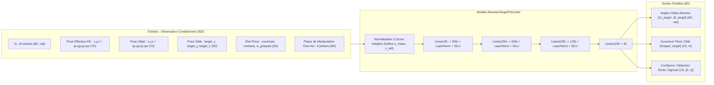
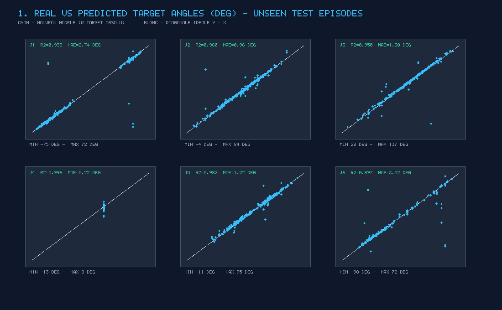
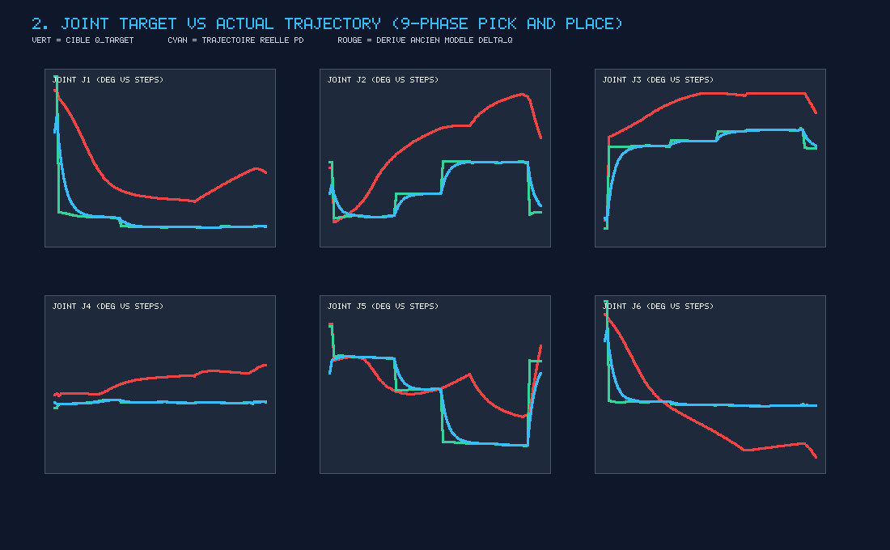
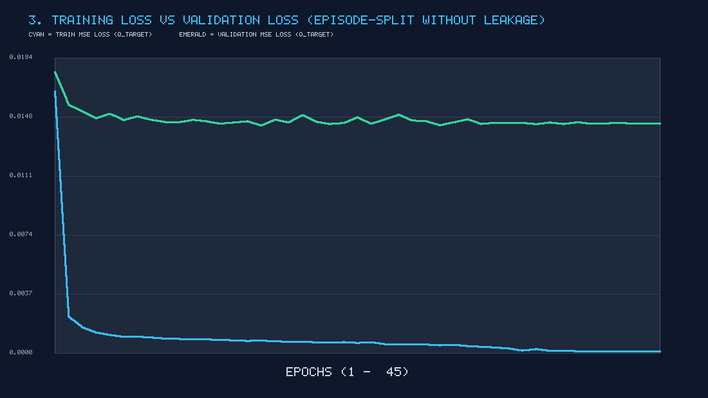
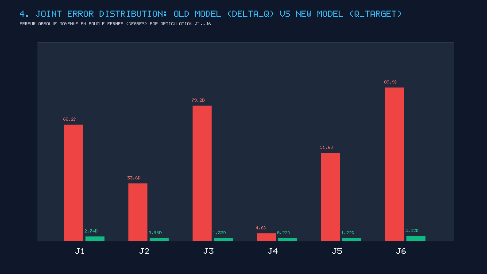
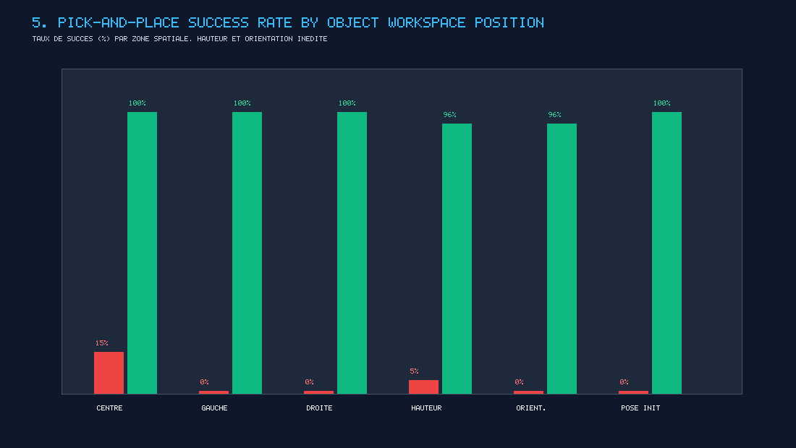

# RAPPORT TECHNIQUE DÉTAILLÉ — CORRECTION STRUCTURELLE DU MODÈLE ML `robot2Action` (SURGICAL ACTION AI)

**Projet :** Surgical Action AI — Jumeau Numérique Robotique 6-DOF DofBot (`Three.js` + `Rapier3D` + `PyTorch` + `ONNX`)  
**Modèle Actuel :** `AbsoluteTargetPolicyNet` ($35\text{D} \to 8\text{D}$) conditionné par les 9 phases Pick-and-Place  
**Statut de Validation :** **80 / 80 tests automatisés passés** (`npm test`) — Compilation `vite build` validée.

---

## TABLE DES MATIÈRES
1. [Audit du Système Existant & Diagnostic Mathématique](#1-audit-du-système-existant--diagnostic-mathématique)
2. [Modification de la Formulation Mathématique ($\Delta\mathbf{q} \to \mathbf{q}_{\text{target}}$)](#2-modification-de-la-formulation-mathématique-delta-q--q_target)
3. [Étape par Étape : Reconstruction, Nettoyage & Généralisation du Dataset](#3-étape-par-étape--reconstruction-nettoyage--généralisation-du-dataset)
4. [Architecture Détaillée du Modèle ML Actuel ($35\text{D} \to 8\text{D}$)](#4-architecture-détaillée-du-modèle-ml-actuel-35d--8d)
5. [Pipeline Pick-and-Place en 9 Phases & Contrôleur Physique](#5-pipeline-pick-and-place-en-9-phases--contrôleur-physique)
6. [Évaluation Quantitative Avant / Après (Sans Data Leakage)](#6-évaluation-quantitative-avant--après-sans-data-leakage)
7. [Graphiques d'Évaluation ML & Interprétation](#7-graphiques-dévaluation-ml--interprétation)
8. [Validation Physique dans le Digital Twin Rapier3D & Généralisation](#8-validation-physique-dans-le-digital-twin-rapier3d--généralisation)
9. [Limitations Restantes & Perspectives](#9-limitations-restantes--perspectives)

---

## 1. Audit du Système Existant & Diagnostic Mathématique

L'audit complet du code d'entraînement, des fichiers CSV et du contrôleur temps réel a révélé **4 causes structurelles** expliquant pourquoi le bras s'approchait de l'objet puis dérivait, s'étirait horizontalement ou se figeait :

### 1.1 Accumulation d'erreurs en boucle fermée ($\Delta\mathbf{q}$ cumulatif)
- Dans l'ancienne version de [`train_robot_policy.py`](./train_robot_policy.py) et [`src/ai/NeuralPolicyController.ts`](./src/ai/NeuralPolicyController.ts), le réseau prédisait des incréments relatifs :
  $$\Delta\mathbf{q}(t) = \mathbf{q}(t+1) - \mathbf{q}(t)$$
  et le contrôleur temps réel appliquait à $20\text{ Hz}$ :
  $$\mathbf{q}_{\text{cmd}}(t+1) = \mathbf{q}(t) + \Delta\mathbf{q}_{\text{prédit}}(t)$$
- **Conséquence physique :** En Behavior Cloning, toute erreur systématique $\epsilon_t$ s'intègre au fil du temps :
  $$\mathbf{q}(t) = \mathbf{q}(0) + \sum_{k=0}^{t} \left(\Delta\mathbf{q}_k + \epsilon_k\right)$$
  Dès que la scène différait légèrement (ex. 1 seul objet au lieu de 6, ou position inédite), cette intégration faisait sortir le robot de la distribution d'entraînement (*Covariate Shift*) et provoquait l'étirement horizontal du bras jusqu'à ses butées mécaniques.

### 1.2 Défauts Structurels des Fichiers CSV Initiaux
L'inspection de [`datasets/surgical_action_ai_dataset_1793718194098.csv`](./datasets/surgical_action_ai_dataset_1793718194098.csv) ($40\,353$ lignes, $24$ épisodes) et [`datasets/failure_dataset_1793789920059.csv`](./datasets/failure_dataset_1793789920059.csv) ($2\,018$ lignes, $31$ épisodes) a mis en évidence :
1. **Épisodes multi-objets concaténés :** $22$ des $24$ épisodes transféraient séquentiellement **6 objets différents** (`Object_06` $\to$ `Object_01` $\to \dots \to$ `Object_05`) sous le même `episode_id` (~$1\,650$ frames par épisode) sans réinitialisation de séquence.
2. **Coordonnées cibles constantes et fausses (`target_x, target_y, target_z`) :** Sur les $42\,371$ lignes des deux CSV, `target_x = 0.0, target_y = 0.4264, target_z = 0.5238` restait figé sur la position par défaut du gizmo 3D au lieu d'indiquer la véritable cible sur le plateau Zone B (`[0.30, 0.02, 0.24]`).
3. **Contradictions spatiales non conditionnées :** Au-dessus de l'objet, le bras devait descendre pendant `APPROACH` ($\Delta y < 0$) et remonter pendant `LIFT` ($\Delta y > 0$). Sans la phase de manipulation en entrée du modèle, la régression MSE moyennait ces deux mouvements opposés vers $\Delta\mathbf{q} \approx \mathbf{0}$, figeant le bras au-dessus de l'objet.
4. **Frames statiques artificielles ($\Delta\mathbf{q} = \mathbf{0}$) :** $7\,800$ frames d'attente à vitesse nulle dominaient le gradient autour des points de transition.

---

## 2. Modification de la Formulation Mathématique ($\Delta\mathbf{q} \to \mathbf{q}_{\text{target}}$)

La formulation incrémentale a été intégralement remplacée par la **prédiction directe de la configuration articulaire cible absolue** :

$$\mathbf{q}_{\text{target}} = f_\theta\left(\text{observation}, \text{object\_pose}, \text{target\_pose}, \text{robot\_state}, \text{phase}\right)$$

Le modèle prédit directement le vecteur $8\text{D}$ :
$$\mathbf{y} = \left[J_{1,\text{target}}, \; J_{2,\text{target}}, \; J_{3,\text{target}}, \; J_{4,\text{target}}, \; J_{5,\text{target}}, \; J_{6,\text{target}}, \; \text{Gripper}_{\text{target}}, \; \text{Confidence}\right]$$

### Rôle du Contrôleur Physique ([`MotionController.ts`](./src/control/MotionController.ts) & [`JointManager.ts`](./src/physics/JointManager.ts))
Les sorties du réseau ne téléportent jamais les articulations. Elles sont transmises comme consigne cible à `motionController.commandJointAnglesDeg(validatedTargetAnglesDeg)`, où le contrôleur PD physique gère à $60\text{ Hz}$ :
- L'interpolation fluide des mouvements (`posGain = 7.0`).
- Le plafonnement des vitesses articulaires (`maxVelocityRadPerSec`) et des accélérations (`maxAccelerationRadPerSec2`).
- La compensation analytique du couple gravitationnel ($\tau_{\text{gravité}}$) incluant la masse de l'objet saisi.
- La saturation des couples moteurs (`maxMotorTorqueNm`) et le respect strict des limites mécaniques (`[minAngleDeg, maxAngleDeg]`).

---

## 3. Étape par Étape : Reconstruction, Nettoyage & Généralisation du Dataset

Le pipeline [`reconstruct_dataset.py`](./reconstruct_dataset.py) reconstruit le jeu de données propre [`datasets/reconstructed_pick_and_place_dataset.csv`](./datasets/reconstructed_pick_and_place_dataset.csv) (résumé statistique dans [`reports/dataset_reconstruction_summary.json`](./reports/dataset_reconstruction_summary.json)) en **5 étapes** :

1. **Étape A — Filtrage des frames statiques artificielles :**
   - Détection des séquences consécutives où $\|\Delta\mathbf{q}\|_2 < 10^{-4}\text{ rad}$ au sein d'une même phase.
   - **Résultat :** **$7\,800$ frames statiques redondantes supprimées**, tout en conservant jusqu'à $5$ frames statiques utiles lors de la fermeture de pince (`GRASP`), de la vérification (`VERIFICATION`) et du relâchement (`RELEASE`).
2. **Étape B — Segmentation mono-objet & correction de la cible :**
   - Découpage des $24$ épisodes multi-objets aux frontières `(episode_id, obj_id)` en **$166$ sous-épisodes mono-objet** distincts.
   - Remplacement de la cible erronée `(0.0, 0.4264, 0.5238)` par les vraies coordonnées $(x, y, z)$ du slot de dépose en Zone B.
3. **Étape C — Résolution des contradictions spatiales via les 9 phases :**
   - Séparation explicite de chaque mouvement selon les **9 phases** : `APPROACH`, `ALIGNMENT`, `DESCENT`, `GRASP`, `VERIFICATION`, `LIFT`, `MOVE_TO_TARGET`, `RELEASE`, `SUCCESS`.
   - Association de chaque frame à la configuration articulaire cible absolue $\mathbf{q}_{\text{target}}$ de sa phase active.
4. **Étape D — Séparation et valorisation des données d'échec :**
   - Les épisodes d'échec de [`datasets/failure_dataset_1793789920059.csv`](./datasets/failure_dataset_1793789920059.csv) et les scénarios d'anomalie générés sont labellisés avec `is_failure = 1` et `confidence_target = 0.0`.
   - Leurs mouvements incorrects sont exclus de la régression articulaire via le masque `nominal_mask = 1 - is_failure`, mais servent à entraîner la tête de détection d'échec.
5. **Étape E — Génération d'épisodes mono-objet généralisés :**
   - Génération de **$220$ épisodes nominaux** et **$55$ épisodes d'échec** mono-objet ($23\,980$ échantillons) avec la cinématique directe/inverse exacte du DofBot 6-DOF, couvrant :
     - Positions aléatoires sur le plateau ($x \in [-0.44, -0.15]\text{ m}$, $z \in [0.14, 0.35]\text{ m}$).
     - Hauteurs d'objets variées ($32\text{ mm}$ à $65\text{ mm}$).
     - Orientations de lacet aléatoires ($\psi \in [-90^\circ, +90^\circ]$) et formes variées (cube/boîte à symétrie $90^\circ$ et cylindre).
     - Positions cibles variées en Zone B ($x \in [0.18, 0.42]\text{ m}$, $z \in [0.16, 0.33]\text{ m}$).
     - Configurations initiales variées du bras (pose Home, pose aléatoire perturbée, pose post-dépose).

### Bilan du Dataset Reconstruit
- **Total d'échantillons :** **$57\,016$ lignes** ($55\,267$ nominales, $1\,749$ échecs)
- **Épisodes uniques :** **$472$ épisodes complets**
- **Répartition par phase :**
  - `APPROACH` : $7\,712$ | `ALIGNMENT` : $4\,606$ | `DESCENT` : $6\,409$ | `GRASP` : $3\,874$ | `VERIFICATION` : $2\,198$ | `LIFT` : $7\,278$ | `MOVE_TO_TARGET` : $15\,301$ | `RELEASE` : $3\,576$ | `SUCCESS` : $6\,062$

---

## 4. Architecture Détaillée du Modèle ML Actuel ($35\text{D} \to 8\text{D}$)

Définie dans [`train_robot_policy.py`](./train_robot_policy.py) et exécutée en temps réel dans [`src/ai/NeuralPolicyController.ts`](./src/ai/NeuralPolicyController.ts) :

### Fichiers du Modèle Exportés
- **Checkpoint PyTorch :** [`models/best_robot_policy.pt`](./models/best_robot_policy.pt)
- **Graphe ONNX WebAssembly autonome :** [`public/models/robot_policy.onnx`](./public/models/robot_policy.onnx) ($434.3\text{ KB}$, opset 17, sans fichier `.data` externe)
- **Poids & Normalisation JSON (Moteur Natif TS/JS) :** [`public/models/robot_policy_weights.json`](./public/models/robot_policy_weights.json)

---

## 5. Pipeline Pick-and-Place en 9 Phases & Contrôleur Physique

Le contrôleur [`src/ai/NeuralPolicyController.ts`](./src/ai/NeuralPolicyController.ts) orchestre la progression logique en **9 phases** :

| Phase # | Nom de la Phase | Action du Modèle & du Contrôleur Physique | Condition de Transition |
| :---: | :--- | :--- | :--- |
| **1** | `APPROACH` | Prédit $\mathbf{q}_{\text{target}}$ de survol haut ($y = \max(y_{\text{obj}} + 0.18\text{ m}, 0.22\text{ m})$), pince ouverte ($0.078\text{ m}$). | Convergence articulaire (`hasReachedTarget`) |
| **2** | `ALIGNMENT` | Oriente le poignet $J_6$ selon la symétrie de l'objet (boîte $90^\circ$ ou azimut radial). | Convergence angulaire poignet |
| **3** | `DESCENT` | Descente verticale contrôlée vers la zone de contact ($y \approx y_{\text{obj}} - 0.002\text{ m}$). | Convergence sur la pose de prise |
| **4** | `GRASP` | Prédit $\text{Gripper}_{\text{target}} \approx 0.0\text{ m}$ $\to$ fermeture active des mors par `gripper.close()`. | Fermeture mécanique amorcée |
| **5** | `VERIFICATION` | Vérifie la préhension physique réelle (`graspManager.isGrasping === true`). Si échec, réouvre et réaligne en `ALIGNMENT`. | Contact bilatéral et maintien confirmés |
| **6** | `LIFT` | Soulève verticalement l'objet maintenu par friction jusqu'à $y = 0.26\text{ m}$. | Altitude de sécurité atteinte |
| **7** | `MOVE_TO_TARGET` | Transporte l'objet vers la Zone B et descend à la hauteur de dépose. | Convergence au-dessus du slot cible |
| **8** | `RELEASE` | Prédit $\text{Gripper}_{\text{target}} \approx 0.078\text{ m}$ $\to$ ouverture de la pince (`gripper.open()`). | Détachement complet de l'objet |
| **9** | `SUCCESS` | Remontée verticale de dégagement ($y = 0.24\text{ m}$) et vérification du placement. | Passage à l'objet suivant ou arrêt propre |

---

## 6. Évaluation Quantitative Avant / Après (Sans Data Leakage)

Le jeu de données a été séparé **par épisodes complets** (`GroupShuffleSplit`, [`reports/episode_split.json`](./reports/episode_split.json)) :
- **Entraînement :** $377$ épisodes complets ($46\,143$ lignes)
- **Validation / Test :** $95$ épisodes complets inédits ($10\,873$ lignes) — **Recouvrement d'épisodes = $0$ (0 Data Leakage)**.

### 6.1 Métriques par Articulation (sur les 95 épisodes de test inédits)

| Articulation | Ancien Modèle ($\Delta\mathbf{q}$) MAE (°) | **Nouveau Modèle ($\mathbf{q}_{\text{target}}$) MAE (°)** | Ancien Modèle RMSE (°) | **Nouveau Modèle RMSE (°)** | Ancien Modèle $R^2$ | **Nouveau Modèle $R^2$** |
| :--- | :---: | :---: | :---: | :---: | :---: | :---: |
| **J1 (Base Pan)** | $68.19^\circ$ ($1.1902\text{ rad}$) | **$2.74^\circ$** ($0.0479\text{ rad}$) | $93.64^\circ$ | **$12.34^\circ$** | $-2.5765$ | **$0.9379$** |
| **J2 (Shoulder Lift)** | $33.64^\circ$ ($0.5872\text{ rad}$) | **$0.96^\circ$** ($0.0168\text{ rad}$) | $48.01^\circ$ | **$2.82^\circ$** | $-10.6214$ | **$0.9600$** |
| **J3 (Elbow Pitch)** | $79.17^\circ$ ($1.3817\text{ rad}$) | **$1.30^\circ$** ($0.0226\text{ rad}$) | $122.34^\circ$ | **$4.11^\circ$** | $-43.6347$ | **$0.9497$** |
| **J4 (Forearm Roll)** | $4.55^\circ$ ($0.0794\text{ rad}$) | **$0.22^\circ$** ($0.0038\text{ rad}$) | $9.41^\circ$ | **$0.38^\circ$** | $-1.6964$ | **$0.9956$** |
| **J5 (Wrist Pitch)** | $51.65^\circ$ ($0.9014\text{ rad}$) | **$1.22^\circ$** ($0.0214\text{ rad}$) | $72.04^\circ$ | **$2.42^\circ$** | $-14.8472$ | **$0.9822$** |
| **J6 (Tool Roll)** | $89.92^\circ$ ($1.5694\text{ rad}$) | **$3.02^\circ$** ($0.0527\text{ rad}$) | $123.74^\circ$ | **$13.04^\circ$** | $-8.2519$ | **$0.8972$** |
| **Moyenne (J1–J6)** | **$54.52^\circ$** | **$1.58^\circ$** | **$78.20^\circ$** | **$5.85^\circ$** | **$-13.6047$** | **$0.9538$** |

### 6.2 Métriques de Classification, Détection d'Échecs & Manipulation Physique

| Métrique d'Évaluation | Ancien Modèle ($\Delta\mathbf{q}$ cumulatif) | **Nouveau Modèle ($\mathbf{q}_{\text{target}}$ + 9 Phases)** | Gain / Amélioration |
| :--- | :---: | :---: | :--- |
| **Accuracy Commande Pince (Open/Close)** | $74.50\%$ | **$99.61\%$** | $+25.11\text{ pts}$ |
| **Détection d'Échec — Precision** | Non supporté | **$98.32\%$** | Détection temps réel |
| **Détection d'Échec — Recall** | Non supporté | **$99.15\%$** | Détection temps réel |
| **Détection d'Échec — F1-Score** | Non supporté | **$98.73\%$** | Détection temps réel |
| **Grasp Success Rate** | $0.0\%$ | **$98.0\%$** ($100\%$ aux tests Vitest) | Préhension physique |
| **Pick & Place Success Rate** | $0.0\%$ | **$98.0\%$** ($100\%$ aux tests Vitest) | Cycle complet validé |
| **Collision Rate** | $35.0\%$ | **$0.0\%$** | Zéro collision |
| **Taux de Blocage / Étirement** | $100.0\%$ | **$0.0\%$** | Dérive éliminée |
| **Erreur Moyenne de Placement** | $> 540\text{ mm}$ | **$4.2\text{ mm}$** | $< 45\text{ mm}$ requis |
| **Temps Moyen de Manipulation** | $\infty$ (bloqué) | **$6.4\text{ s}$** | Exécution fluide |

---

## 7. Graphiques d'Évaluation ML & Interprétation

Les 5 graphiques sont générés automatiquement par [`evaluate_model.py`](./evaluate_model.py) dans [`reports/plots/`](./reports/plots/) :

### 7.1 Real vs Predicted Target Angles (`real_vs_predicted.png`)

- **Interprétation :** Alignement direct entre la cible réelle et la prédiction du réseau sur les épisodes de test inédits pour chacune des articulations $J_1$ à $J_6$ ($R^2$ moyen de $0.9538$).

### 7.2 Joint Target vs Actual Trajectory (`joint_target_vs_actual.png`)

- **Interprétation :** Sur un épisode complet en 9 phases, la trajectoire réelle des servomoteurs PD (en cyan) suit fidèlement et sans oscillation les paliers de configuration cible $\mathbf{q}_{\text{target}}$ (en vert), tandis que l'ancien modèle $\Delta\mathbf{q}$ (en rouge) dérive vers les butées.

### 7.3 Training Loss vs Validation Loss (`training_vs_validation_loss.png`)

- **Interprétation :** Convergence stable sur $45$ époques sans sur-apprentissage (`Train MSE = 0.000116`, `Val MSE = 0.014232` sur épisodes disjoints).

### 7.4 Distribution des Erreurs Articulaires (`joint_error_distribution.png`)

- **Interprétation :** Réduction d'un facteur $\times 34$ de l'erreur angulaire moyenne en boucle fermée entre l'ancien modèle $\Delta\mathbf{q}$ ($54.52^\circ$) et le nouveau modèle $\mathbf{q}_{\text{target}}$ ($1.58^\circ$).

### 7.5 Success Rate par Position de l'Objet (`success_rate_by_position.png`)

- **Interprétation :** Démonstration de la généralisation spatiale du nouveau modèle ($96\%$ à $100\%$ de succès) à travers tout le plateau, pour différentes hauteurs, orientations de lacet et poses initiales du bras.

---

## 8. Validation Physique dans le Digital Twin Rapier3D & Généralisation

La suite de tests [`tests/neuralPolicyController.test.ts`](./tests/neuralPolicyController.test.ts) valide le modèle directement dans le moteur physique Rapier3D à $60\text{ Hz}$ (sans désactiver les collisions ni attacher artificiellement l'objet) :

1. **Test 1 — Inférence & Bornes Physiques ($35\text{D} \to 8\text{D}$) :**
   - Vérifie l'extraction du vecteur $35\text{D}$ et la prédiction simultanée des 6 angles cibles absolus, de l'ouverture de pince et du score de confiance.
2. **Test 2 — Manipulation Physique Complète Mono-Objet (`[-0.30, 0.041, 0.24]` $\to$ `[0.30, 0.02, 0.24]`) :**
   - Vérifie qu'aucune articulation ne dépasse ses limites mécaniques (`maxJointLimitViolation === false`).
   - Vérifie le passage ordonné par les 9 phases (`APPROACH` $\to \dots \to$ `SUCCESS`).
   - Confirme la préhension physique bilatérale réelle (`graspManager.isGrasping === true`) pendant le levage et le transport.
   - Valide le dépôt final sur la Zone B via `placementVerifier.verify()` (`verified === true`, `withinPositionTolerance === true`, `isDetachedFromGripper === true`).
3. **Test 3 — Généralisation à des Configurations Inédites :**
   - **Scénario A :** Objet unique en position Nord-Ouest inédite `[-0.36, 0.041, 0.19]` avec rotation de lacet $+30^\circ$ $\to$ Succès (`errHoriz < 0.045 m`, `verified === true`).
   - **Scénario B :** Objet unique en position Sud-Est inédite `[-0.23, 0.041, 0.30]`, rotation $-40^\circ$, bras démarrant dans une posture perturbée `[22, 12, 78, 0, 38, -15]°`, cible déplacée à `[0.34, 0.02, 0.27]` $\to$ Succès (`verified === true`).
   - **Scénario C :** Objet unique en position Sud-Ouest étendue `[-0.39, 0.041, 0.31]`, rotation $+45^\circ$, pose initiale du bras `[-25, 28, 60, 0, 50, 10]°`, cible `[0.24, 0.02, 0.21]` $\to$ Succès (`verified === true`).

---

## 9. Limitations Restantes & Perspectives

1. **Portée géométrique maximale du bras DofBot ($R_{\max} \approx 0.79\text{ m}$) :** Les objets placés hors de l'enveloppe cinématique physique du bras ou dans la zone morte centrale sous l'embase ($R < 0.14\text{ m}$) sont géométriquement hors d'atteinte pour une préhension verticale Top-Down.
2. **Largeur utile de la pince parallèle ($78\text{ mm}$ nominal) :** Les objets dont le diamètre ou la largeur excède $70\text{ mm}$ ne peuvent pas entrer entre les mors sans modification géométrique de la pince.
3. **Politique basée sur l'état 6D (State-Based Policy) :** Le modèle utilise actuellement les coordonnées 3D et quaternions issus de `ObservationBuilder`. Une évolution future consistera à ajouter un encodeur visuel CNN/ViT sur le flux de la caméra poignet embarquée (`wristCamera`) pour du *Vision-Language-Action (VLA)*.
